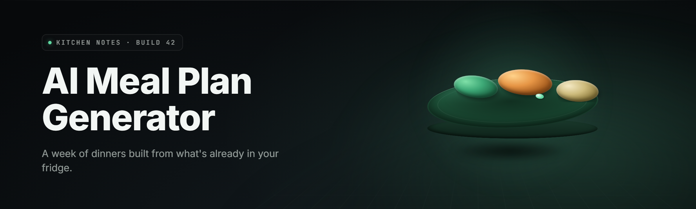

  
  
  

  

  
  
  

---

**A local-first meal-planning suite that turns your fridge, macros, and allergies into a week of food you'll actually cook.**

---

## 🍽️ What is the AI Meal Plan Generator — Term Glossary

The AI Meal Plan Generator is a **Windows desktop suite** that reads what you actually have, what you actually want to hit (calories, protein, budget), and what you actually can't eat (allergies, dislikes, religious rules), then outputs a cookable 7-day plan with a consolidated shopping list. No cloud account, no subscription, no phone-home. It runs on your machine, on your data.

| Term | Explanation |
|------|-------------|
| **Plan Pass** | One generation cycle that outputs a 7-day grid from your pantry + goals. |
| **Pantry Snapshot** | A saved inventory of what's in your fridge/freezer/pantry, used to bias suggestions. |
| **Macro Target** | Your daily protein/carb/fat/calorie ceilings and floors. Feeds the solver. |
| **Constraint Set** | Allergies, dislikes, diet rules (keto, halal, vegan, low-FODMAP) applied as hard filters. |
| **Recipe Card** | A single normalized recipe: ingredients, steps, macros, prep time, cost estimate. |
| **Swap Chain** | The ranked list of substitutions the engine offers when a recipe breaks a constraint. |
| **Batch Block** | A grouped cook session — recipes that share prep and can be made in one sitting. |

**Why people use it:**

- 🧊 Cooks from what's already in the fridge instead of generating a fantasy shopping trip.
- 🎯 Hits macro targets without you doing spreadsheet math at 9pm.
- 🛒 Collapses 7 days of recipes into one deduped shopping list with quantities summed.
- 🚫 Respects allergies as hard blocks, not "suggestions you can ignore."
- 💸 Tracks an estimated weekly cost per plan so budget mode is real.
- 🔌 Works offline — the planner engine is bundled, no API key, no signup.

---

## 📖 Table of Contents

- [Overview](#-overview)
- [What is the AI Meal Plan Generator — Term Glossary](#-what-is-the-ai-meal-plan-generator--term-glossary)
- [Key Features](#-key-features)
- [All Modules Status](#-all-modules-status)
- [The Problem](#-the-problem)
- [The Solution](#-the-solution)
- [Pantry & Inventory Modules](#-pantry--inventory-modules)
- [Planning & Solver Modules](#-planning--solver-modules)
- [Nutrition & Health Modules](#-nutrition--health-modules)
- [Shopping & Budget Modules](#-shopping--budget-modules)
- [Recipe & Cooking Modules](#-recipe--cooking-modules)
- [Import, Export & Sync Modules](#-import-export--sync-modules)
- [Quick Start](#-quick-start)
- [Comparison](#-comparison)
- [System Requirements](#-system-requirements)
- [Installation](#-installation)
- [Known Issues](#-known-issues)
- [Changelog](#-changelog)
- [FAQ](#-faq)

---

## 🗂️ Overview

| Category | Details |
|----------|---------|
| **Name** | AI Meal Plan Generator |
| **Type** | Windows desktop suite (`.exe`) |
| **Version line** | v2.4.x (2026 branch) |
| **Planner engine** | Bundled local solver, no external API required |
| **Data model** | SQLite vault on disk — pantry, recipes, plans, history |
| **Import** | Recipe URL paste, CSV, JSON, Apple Health / Fitbit export |
| **Export** | PDF plan, CSV shopping list, printable recipe cards |
| **Diet presets** | Keto, paleo, vegan, vegetarian, halal, kosher, low-FODMAP, high-protein |
| **Offline** | Fully functional offline after first launch |

The suite is built around a simple loop: **inventory in → constraints applied → plan out → list generated → cook → log → repeat.** Every module below is a piece of that loop. The engine is deterministic given the same inputs, so a plan you liked on Tuesday you can regenerate on Friday and get the same grid — unless you changed something, in which case you get a diff view showing what shifted.

See the FAQ for detection/updates notes on the installer and vault.

---

## ⬇️ Download

  

---

## 🧩 Key Features

| Feature | Description | Benefit |
|---------|-------------|---------|
| Pantry-aware planning | Biases recipes toward ingredients you already own; flags what's missing | Less waste, fewer trips |
| Hard constraint solver | Allergies and diet rules are hard filters, not soft nudges | Safe plans, zero babysitting |
| Macro targeting | Set daily protein/carb/fat/calorie bands per day of week | Hits training goals |
| Budget mode | Assigns cost estimates, caps weekly spend, suggests cheaper swaps | Predictable grocery bill |
| Shopping list builder | Sums duplicate ingredients across the week, rounds to buyable units | One clean list |
| Batch cook planner | Groups recipes sharing prep into cook blocks | Saves hours |
| Leftover chaining | Reuses cooked portions across days before they expire | Fights food waste |
| Recipe importer | Paste a URL or CSV; engine normalizes to a recipe card | Bring your own library |
| Allergen scanner | Flags hidden allergens in imported recipes | Safety net |
| Plan diff view | Shows exactly what changed between two plans | Trust the changes |
| Printable cards | PDF export of recipe cards + shopping list | Fridge-ready |
| Offline vault | Everything stored locally in SQLite | No account, no cloud |

---

## ✅ All Modules Status

| Module | Status | Description |
|--------|--------|-------------|
| Pantry Scanner | ✅ Working | Inventory CRUD with barcode and manual entry |
| Fridge Decay Timer | ✅ Working | Flags items nearing expiry to prioritize them |
| Constraint Solver | ✅ Working | Hard-filter engine for allergies and diet rules |
| Macro Solver | ✅ Working | Band-based daily target fitter |
| Budget Optimizer | ✅ Working | Cost caps and cheap-swap ranking |
| Shopping List Builder | ✅ Working | Dedupes and sums across the week |
| Batch Cook Planner | ✅ Working | Groups shared-prep recipes |
| Leftover Chain | ✅ Working | Reuses cooked portions before expiry |
| Recipe Importer (URL) | ✅ Working | Parses pasted recipe URLs |
| Recipe Importer (CSV) | ✅ Working | Bulk import from spreadsheet export |
| Allergen Scanner | ✅ Working | Detects hidden allergens in imports |
| Plan Diff View | ✅ Working | Compares two plans side by side |
| PDF Exporter | ✅ Working | Plan + cards + list to PDF |
| CSV Exporter | ✅ Working | Shopping list and macro log |
| Health Sync (Apple/Fitbit) | ✅ Working | Imports activity to adjust calories |
| Vault Backup | ✅ Working | SQLite snapshot + restore |
| Diet Preset Library | ✅ Working | 8 premade rule sets |
| Custom Diet Builder | ✅ Working | Build your own rule set |
| Water/Prep Timer | ✅ Working | Cook-time and hydration reminders |
| Multi-Profile Support | ✅ Working | Separate vaults per household member |
| Unit Converter | ✅ Working | Metric/imperial across all recipes |
| Leftover Recipe Finder | ✅ Working | Suggests uses for leftover components |
| Macro Log | ✅ Working | Tracks actual vs. planned intake |
| Seed Data Pack | ✅ Working | ~400 starter recipes bundled |
| Auto-Updater | ✅ Working | Signed update channel |

---

## 😤 The Problem

- You open a meal-planning app and it generates a plan built around ingredients you don't own and won't buy.
- Every allergy is a "suggestion" you have to re-check manually, every single week.
- Macro targets are shown but never actually solved for — you still do the math.
- The shopping list is 7 separate lists glued together with duplicate entries.
- Recipe importers break the moment a site changes its layout, and you lose your library.
- "Cloud sync" means your food log leaves your machine whether you like it or not.
- Batch cooking advice is generic; nothing groups recipes that share a cutting board.

---

## 🛠️ The Solution

| Problem | Solution |
|---------|----------|
| Plans built on ingredients you don't own | Pantry Snapshot biases every generation toward your real inventory |
| Allergies treated as soft suggestions | Constraint Solver treats them as hard filters — plans can't include them |
| Macro targets not solved for | Macro Solver fits daily bands during generation, not after |
| Duplicate shopping entries | Shopping List Builder dedupes and sums to buyable units |
| Importers that break silently | Recipe Importer falls back to manual card entry and warns on parse failure |
| Cloud sync you didn't ask for | Vault stays local; sync is opt-in file export only |
| Generic batch-cook advice | Batch Cook Planner groups by shared prep and cook vessel |

---

## 🧊 Pantry & Inventory Modules

The pantry layer is the foundation the whole suite stands on. It's not a static list — it's a living inventory with decay timers, location tags (fridge, freezer, pantry, spice rack), and quantity tracking that updates when you cook. Every generation pass reads this layer first, so a stuffed fridge produces a different plan than an empty one. The inventory is editable by hand, by barcode, or by bulk CSV, and it survives vault backups without schema breakage across minor versions.

- **Pantry Scanner** — add/remove/edit items with quantity, unit, and location.
- **Fridge Decay Timer** — flags items nearing expiry so the solver prioritizes them.
- **Location Tags** — fridge, freezer, pantry, spice rack; plans route accordingly.
- **Bulk CSV Import** — paste a spreadsheet of what you have and it's in.
- **Auto-Deplete** — cooking a recipe deducts its ingredients from inventory.

---

## 🧠 Planning & Solver Modules

This is the brain. The solver takes your pantry, constraints, and macro bands, then searches recipe space for a 7-day grid that fits. It's deterministic — same inputs, same plan — and it produces a diff whenever you change anything, so you always know why Tuesday's dinner shifted. The solver is local, bundled, and runs in a couple of seconds on a normal laptop; there's no server round-trip and no rate limit.

- **Constraint Solver** — hard filters for allergies, diet rules, and dislikes.
- **Macro Solver** — fits daily protein/carb/fat/calorie bands.
- **Budget Optimizer** — caps weekly spend and ranks cheap swaps.
- **Plan Diff View** — shows exactly what changed between two plans.
- **Determinism Guard** — regenerating the same inputs yields the same grid.
- **Plan History** — every generated plan is saved and re-loadable.

---

## 🥦 Nutrition & Health Modules

Nutrition is where the suite earns its keep. Instead of showing numbers after the fact, it solves for them during generation, then logs what you actually ate so you can see drift. Health sync imports activity data to nudge calorie bands up or down on training days. Multi-profile support means a household with three different diets gets three separate vaults that never bleed into each other.

- **Macro Log** — planned vs. actual intake, tracked per day.
- **Health Sync** — imports Apple Health / Fitbit activity to adjust calories.
- **Diet Preset Library** — keto, paleo, vegan, vegetarian, halal, kosher, low-FODMAP, high-protein.
- **Custom Diet Builder** — build your own rule set from scratch.
- **Multi-Profile Support** — separate vaults per household member.
- **Water/Prep Timer** — hydration and cook-time reminders.

---

## 🛒 Shopping & Budget Modules

The shopping layer turns seven days of recipes into one list you can actually take to a store. It sums duplicate ingredients, rounds fractional quantities up to buyable units, groups by aisle when you tag aisles, and estimates a total cost. Budget mode adds a hard cap: if the week's estimate exceeds your number, the optimizer swaps recipes until it fits or tells you it can't.

- **Shopping List Builder** — dedupes and sums across the week.
- **Aisle Grouping** — optional tags sort the list by store section.
- **Cost Estimator** — per-item and weekly totals from your price book.
- **Budget Cap** — hard weekly limit with swap suggestions.
- **CSV Exporter** — shopping list to spreadsheet.
- **Price Book** — your own per-store pricing, editable.

---

## 🍳 Recipe & Cooking Modules

Recipes are the atoms of the plan. The suite ships with a seed pack, imports your own, and normalizes everything to a recipe card with consistent units and macros. Batch cooking is a first-class concept: the planner groups recipes that share prep so you can knock out three meals in one session. Leftover chaining reuses cooked portions across days before they expire, which is the single biggest waste-reducer in the suite.

- **Recipe Importer (URL)** — paste a recipe link, get a normalized card.
- **Recipe Importer (CSV)** — bulk import from a spreadsheet.
- **Recipe Card Editor** — fix anything the importer got wrong.
- **Batch Cook Planner** — groups recipes by shared prep and vessel.
- **Leftover Chain** — reuses cooked portions before expiry.
- **Leftover Recipe Finder** — suggests dishes for leftover components.
- **Seed Data Pack** — ~400 starter recipes bundled.

---

## 🔄 Import, Export & Sync Modules

The suite is local-first, but it's not a walled garden. You can export a PDF plan, a CSV list, or a full vault snapshot; you can import recipes from the web or a spreadsheet; and you can sync the vault to a file-sync folder you control. There's no account, no telemetry, and no phone-home — the auto-updater is the only network call, and it's signed and togglable.

- **PDF Exporter** — plan, recipe cards, and shopping list.
- **CSV Exporter** — shopping list and macro log.
- **Vault Backup** — SQLite snapshot + restore.
- **Vault Sync** — opt-in file-sync folder export.
- **Allergen Scanner** — flags hidden allergens on import.
- **Auto-Updater** — signed update channel, toggleable.

---

## ⏱️ Quick Start

1. 🖥️ Visit the project page and grab the installer for your Windows build.
2. 📦 Extract the archive to a folder you control (not Program Files if you want portable mode).
3. ▶️ Run the `.exe`; on first launch it creates a local vault and seeds ~400 recipes.
4. 🧊 Add what's in your fridge via the Pantry Scanner (or skip and let it plan freely).
5. 🎯 Set your macro bands and allergies, then hit **Generate Plan**.

That's the whole loop. Everything after that is editing, cooking, and logging.

---

## ⚖️ Comparison

| Aspect | Typical cloud app | This Tool |
|--------|-------------------|-----------|
| Account required | Yes | No |
| Data location | Vendor servers | Local SQLite vault |
| Allergy handling | Soft suggestions | Hard constraint filter |
| Macro solving | Post-hoc display | Solved during generation |
| Shopping list | Per-recipe lists | Deduped weekly list |
| Batch cooking | Generic tips | Shared-prep grouping |
| Offline use | Broken or degraded | Fully functional |
| Recipe library portability | Locked to vendor | Exportable CSV/JSON |

---

## 🖥️ System Requirements

| Component | Minimum | Recommended |
|-----------|---------|-------------|
| OS | Windows 10 (64-bit) | Windows 11 (64-bit) |
| CPU | Dual-core 2.0 GHz | Quad-core 3.0 GHz |
| RAM | 4 GB | 8 GB |
| Storage | 500 MB free | 2 GB free (larger recipe library) |
| Display | 1280×720 | 1920×1080 |
| Runtime | .NET 8 Desktop Runtime | Bundled with installer |
| Network | Optional (updates only) | Optional |

---

## 📥 Installation

1. **Download.** Grab the current installer from the project page. The archive contains the signed `.exe` and a `README.txt` with the same steps.
2. **Extract.** Right-click the archive → Extract All. Run from a folder you own if you want portable mode; the vault lives next to the `.exe` by default.
3. **Run.** Double-click the `.exe`. First launch seeds the recipe pack and creates the vault. No admin rights required unless you install to a protected path.

> The installer is signed. If Windows SmartScreen flags a fresh build, choose **More info → Run anyway** — the signature hash is published in the release notes.

---

## 🐛 Known Issues

| Issue | Solution |
|-------|----------|
| Recipe URL import fails on some sites | Fall back to manual card entry; the parser warns and keeps your draft |
| Macro log shows drift after midnight | Set your day-boundary hour in Settings → Nutrition |
| Health sync misses some devices | Export CSV from the device app and import manually |
| Batch planner suggests too many recipes | Lower the batch size cap in Settings → Cooking |
| PDF export renders slow on huge plans | Export per-week instead of full month |
| Vault sync conflicts on two machines | Use one primary writer or enable file-lock mode |

---

## 📝 Changelog

- **v2.4.1** — Determinism guard added; plan regeneration is now byte-stable.
- **v2.4.0** — Budget optimizer rewritten with hard caps and swap ranking.
- **v2.3.2** — Allergen scanner extended to imported CSV recipes.
- **v2.3.0** — Batch cook planner and leftover chain shipped.

---

## ❓ FAQ

Is there a detection/updates note for the installer?

The installer is code-signed and the auto-updater pulls from a signed channel. SmartScreen may flag brand-new builds for a few days until reputation accrues; the published hash lets you verify manually. See the release notes for the current signature.

Does the planner need an internet connection?

No. The engine is bundled and runs locally. The only network call is the auto-updater, which you can disable in Settings.

Where is my data stored?

In a local SQLite vault next to the `.exe` (or in `%AppData%` if you chose installed mode). You can back it up, move it, or sync it to a folder you control.

Can I import my own recipes?

Yes — paste a URL or bulk-import a CSV. The importer normalizes to a recipe card and the allergen scanner flags anything suspicious.

How does budget mode work?

You set a weekly cap and a price book. The optimizer swaps recipes until the estimate fits, or tells you the closest it can get.

**Q:** Are allergies really hard-blocked?
**A:** Yes. The constraint solver treats them as filters, not nudges. A plan that violates a constraint won't generate.

**Q:** Can multiple people use one install?
**A:** Yes — each profile gets its own vault. Plans, logs, and constraints stay separate.

**Q:** Does it work offline after install?
**A:** Fully. First launch seeds the recipe pack and you're set.

**Q:** What happens if a recipe URL changes layout?
**A:** The importer warns, keeps your draft, and lets you finish the card manually.

---

The AI Meal Plan Generator is built for people who cook from what they have and want the math done for them. It stays local, stays deterministic, and stays out of your way once the plan is on the fridge. If your fridge is full and your week is empty, this is the tool that closes the gap — aight, chef, that's the plate.

  

